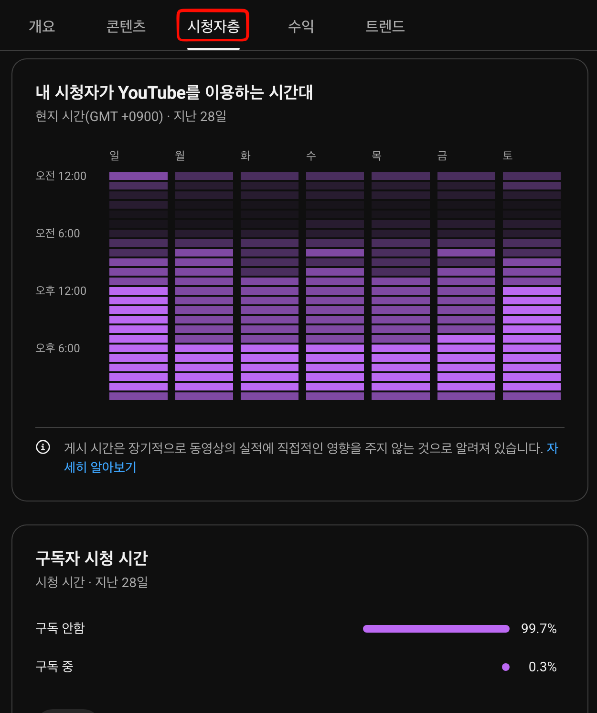

이 글은 8월에 처음 올렸고 10월 14일에 채널 데이터로 다시 썼습니다.

처음 글에서는 시청자가 가장 많은 시간보다 1\~2시간 먼저 올리라고 적었습니다.\
제 채널 경험에서 나온 원칙이라고 했습니다.

그런데 그 원칙을 숫자로 확인한 적은 없었습니다.\
이번에 영상을 모두 업로드 시각별로 나눠 보니 그 원칙과 맞지 않는 결과가 나왔습니다.

그래서 처음부터 다시 씁니다.

제가 운영하는 쇼츠 채널(이하 채널 A)의 쇼츠 122편입니다.\
막 올린 영상처럼 같은 선에서 비교하기 어려운 영상은 뺐습니다.\
조회수는 10월 6일 기준이고 업로드 시각은 한국 시간입니다.

## 시간대별로 나눠 본 122편

| 업로드 시각 | 편수 | 조회수 중앙값 | 10만 회 이상 |
|---|---|---|---|
| 자정\~오전 6시 | 7 | 약 6.9만 | 3편 (43%) |
| 오전 6시\~정오 | 38 | 약 4.6만 | 10편 (26%) |
| 정오\~오후 6시 | 17 | 약 5.5만 | 7편 (41%) |
| 오후 6시\~9시 | 23 | 약 3.8만 | 4편 (17%) |
| 오후 9시\~자정 | 37 | 약 6.0만 | 17편 (46%) |

새벽은 7편뿐이라 따로 놓겠습니다.\
나머지 중에서는 밤 9시\~자정이 가장 좋았고 저녁 6시\~9시가 가장 낮았습니다.

처음 글의 원칙대로라면 저녁 6\~7시 업로드가 유리했어야 합니다.\
이 채널에서 그 시간대는 오히려 맨 아래였습니다.

## 잘 된 20편과 안 된 20편의 업로드 시각

조회수 상위 20편과 하위 20편으로 나눠도 비슷했습니다.

상위 20편 중 10편이 밤 9시\~자정에 올라갔습니다.\
하위 20편은 6편입니다.

저녁 6시\~9시는 반대였습니다.\
상위 20편 중 2편, 하위 20편 중 5편이었습니다.

업로드 시각의 중앙값도 상위 20편은 오후 8시 15분, 하위 20편은 오후 6시 23분이었습니다.

두 묶음이 그 밖에 무엇이 달랐는지는 [조회수 안 나온 쇼츠 20편, 잘 된 20편과 무엇이 달랐나](/blog/2026-10-14-shorts-low-views-bottom-20-vs-top-20/)에 정리했습니다.

## 그래도 밤 9시가 정답이라고 할 수 없는 이유

밤 9시 이후에 올린 37편 중 30편이 4월부터 6월 사이에 몰려 있습니다.\
이 채널이 일주일에 다섯 편 넘게 올리던 시기입니다.

3월에는 반대로 오전 업로드가 많았습니다.\
3월에 올린 26편 중 17편이 오전 6시\~정오였습니다.

그러니 이 표가 보여 주는 차이가 시간대 때문인지 시기 때문인지 가를 수 없습니다.\
그 시기에 올린 영상의 내용까지 같았다고 장담할 수도 없습니다.

YouTube 스튜디오도 비슷한 안내를 붙여 둡니다.\
시청자층 화면의 시간대 히트맵 바로 아래에 이런 문장이 있습니다.

> 게시 시간은 장기적으로 동영상의 실적에 직접적인 영향을 주지 않는 것으로 알려져 있습니다.

이 채널의 데이터도 그 안내와 어긋나지 않습니다.\
시간대마다 차이가 보이긴 했지만 시간대만 바꿔서 생긴 차이라는 증거는 없었습니다.

## 스튜디오 히트맵으로 내 시청자의 시간 보기

그래도 내 시청자가 언제 YouTube를 쓰는지는 알아 둘 만합니다.\
업로드 직후 몇 시간은 그 시간에 접속해 있는 사람들에게 먼저 보이기 때문입니다.

8월 1일부터 28일까지의 채널 A 히트맵입니다.

평일은 오후 5\~6시부터 밤 11시까지가 가장 밝습니다.\
토요일과 일요일은 정오부터 밝아져 밤까지 이어집니다.\
자정부터 오전 6시까지는 모든 요일이 어둡습니다.

아래쪽 구독자 시청 시간은 구독하지 않은 사람이 99.7%입니다.\
시청 시간 거의 전부가 구독하지 않은 사람에게서 나왔습니다.

히트맵은 이렇게 엽니다.

1. [YouTube Studio](https://studio.youtube.com)에 들어갑니다.
2. 왼쪽 메뉴에서 분석을 누릅니다.
3. 위쪽 탭에서 시청자층을 고릅니다.
4. "내 시청자가 YouTube를 이용하는 시간대"를 찾습니다.

화면 구성은 YouTube 고객센터의 [YouTube Analytics 시작하기](https://support.google.com/youtube/answer/9002587)에 나와 있습니다.

## 내 채널에서 해 볼 계산

히트맵은 시청자가 언제 접속하는지를 보여 줄 뿐입니다.\
언제 올린 영상이 잘 됐는지는 직접 세어 봐야 합니다.

스튜디오의 콘텐츠 목록에서 영상마다 업로드 시각과 조회수를 적습니다.\
시간대를 네다섯 칸으로 나누고 칸마다 조회수 중앙값을 구합니다.

여기서 한 가지를 꼭 같이 봅니다.\
어느 시간대가 좋아 보이면 그 시간대 영상이 특정 달에 몰려 있지 않은지 확인합니다.

몰려 있다면 이 채널처럼 시간대의 효과를 따로 떼어 볼 수 없습니다.\
그럴 때는 몇 주 동안 같은 시기에 시간대만 바꿔 올려 보는 편이 더 나은 비교가 됩니다.

## 처음 글에서 뺀 내용

처음 글에는 근거 없는 기준이 몇 개 들어 있었습니다.\
업로드 직후 수천 명에게 먼저 보여 준다는 것, 시청 완주율 60%를 넘으면 배포가 넓어진다는 것, 이탈률이 50%를 넘으면 제목을 바꾸라는 것입니다.

공식 문서에서 이런 숫자를 찾지 못했고 제가 측정한 적도 없습니다.\
그래서 모두 지웠습니다.

일요일과 월요일이 유리하다는 요일 전략도 뺐습니다.\
이 채널의 상위 20편과 하위 20편은 요일별로 나눠 봐도 뚜렷한 차이가 없었습니다.

피드에서 쇼츠를 넘기지 않고 보기로 선택한 비율을 영상마다 확인하는 방법은 YouTube 고객센터의 [Content 탭 분석 도움말](https://support.google.com/youtube/answer/12942217?hl=en&co=YOUTUBE._YTVideoType%3Dshorts)에 나와 있습니다.

## 이 숫자를 믿기 전에 알아 둘 점

채널 하나, 영상 122편의 기록입니다.\
지운 영상은 빠져 있고 시간대마다 영상이 7편에서 38편뿐입니다.

예약 공개한 영상은 예약된 공개 시각으로 셌습니다.\
시청자가 많은 시간대는 채널마다 다르니 이 표의 시간을 그대로 옮겨 쓰기는 어렵습니다.

이 채널에서 업로드 시각의 차이는 업로드한 시기, 업로드 빈도의 차이와 겹쳐 있었습니다.\
시간대를 고민하기 전에 그 둘부터 나눠 보시길 권합니다.
