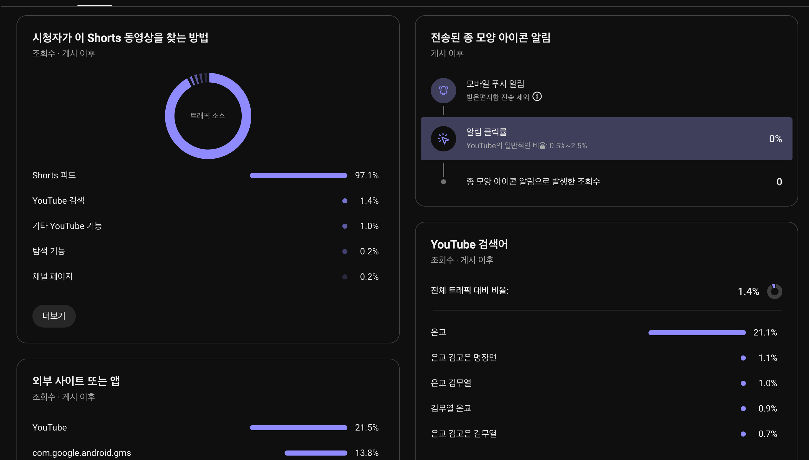
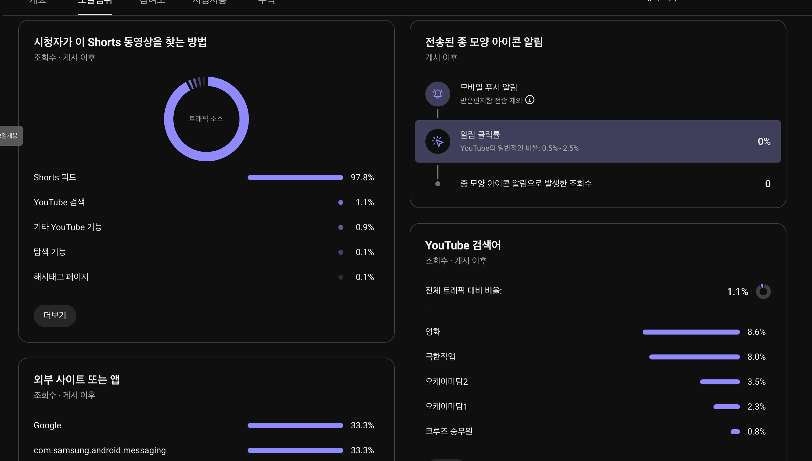

## 제목에 작품명을 넣을지 고민될 때

쇼츠를 만들 때 누구나 비슷한 고민을 합니다. 피드에서 스크롤을 멈추게 하려면 직관적이고 자극적인 상황 묘사가 필요한데, 그렇게 쓰다 보면 검색 유입을 위한 '작품명'이나 '인물명' 같은 핵심 키워드가 빠지게 됩니다. 반대로 검색어에 맞춰 제목을 지으면 피드에서 밋밋해 보입니다.

제 채널에서는 제목과 실제 검색 유입 키워드가 전혀 다른 영상이 있었습니다.

영상 2편의 스튜디오 도달범위 화면으로 그 모습을 살펴보겠습니다.

## 제목에 '은교'를 한 글자도 안 썼는데 검색 1위로 잡힌 까닭

자체 운영 채널에 올렸던 영화 리뷰 쇼츠 중 '[Case A] 캐릭터 명대사 코믹 쇼츠 (43초)'이라는 영상이 있습니다.

제목만 보면 어떤 영화인지 전혀 알 수 없습니다. 오직 영상 속 캐릭터의 웃긴 상황에만 집중해서 제목을 붙였습니다. 그런데 이 영상의 유튜브 스튜디오 도달범위 탭을 열어보고 깜짝 놀랐습니다.

데이터가 보여주는 결과는 명확했습니다.
* 전체 트래픽의 97.1%는 쇼츠 피드에서 발생했습니다.
* 검색어 1위는 21.1%의 비중을 차지한 '은교'였습니다. 이어서 '은교 김고은 명장면', '은교 김무열' 같은 원작 관련 키워드들이 줄줄이 뒤를 이었습니다.

제목에 영화 이름이 없는데 어떻게 이 검색어로 들어왔는지는 YouTube가 공개하지 않습니다. 설명란과 해시태그, 영상 속 음성과 자막 가운데 무엇이 작용했는지는 이 화면만으로 가릴 수 없습니다.
다만 이 영상에서는 제목에 작품명이 없어도 작품명 검색 유입이 들어왔습니다.

## 상황 설명은 제목 앞에, 고유명사는 해시태그 뒤로 넘기는 분리법

그렇다면 피드와 검색 유입을 함께 챙기려면 제목을 어떻게 구성해야 할까요? 제가 다음으로 올린 *"[Case C] 코믹 액션 영화 쇼츠 (33초)"* 영상의 데이터입니다.

이 영상의 검색어 유입은 이렇게 나뉘었습니다.
* '영화' (8.6%): 가장 대중적이고 포괄적인 탐색 키워드가 잡혔습니다.
* '극한직업' (8.0%): 제목 앞부분의 표현과 겹치는 검색어입니다.
* '원작작품명 키워드' (3.5%), '관련 시리즈명' (2.3%): 제목 맨 뒤 해시태그에 넣어 둔 작품명으로도 검색 유입이 있었습니다.

| 위치 | 실제 텍스트 | 역할 및 노림수 |
|---|---|---|
| 제목 앞단 (1~15자) | "[Case C] 코믹 액션 영화 쇼츠 (33초)" | 피드에서 상황을 바로 알 수 있게 함 |
| 제목 뒷단 해시태그 | "#원작작품명 #장르태그" | 작품명 검색어와 영상을 연결 |
| 추가 해시태그 | "#8월12개봉" | 개봉 시기 검색어와 연결 |

제목 앞부분은 사람이 읽는 상황 설명에 쓰고, 검색에 필요한 고유명사는 뒤쪽 해시태그로 보내는 방식입니다.
두 편의 결과라 일반 규칙이라고 하기는 어렵습니다. 제 채널에서는 이 방식으로 피드와 검색 유입이 함께 들어왔습니다.

## 제가 쓰는 쇼츠 제목 작성 순서

위 두 편 이후 제가 제목을 쓸 때 지키는 순서입니다.

1. 앞 15자에는 감정과 상황만 담기: 설명을 포기하고, 시청자가 머릿속으로 장면을 상상할 수 있는 단어(진상, 멘붕, 대참사, 실수 등)를 먼저 던집니다.
2. 작품명과 브랜드는 해시태그로 빼기: 검색 유입에 필요한 고유명사는 제목 뒤편 해시태그(#)에 넣어 피드에서의 가독성을 해치지 않도록 합니다.
3. 자막과 제목의 역할 분담: 영상 속 첫 자막과 제목이 똑같은 말을 반복하지 않고, 서로 다른 호기심을 자극하도록 배치합니다.
4. 내 영상의 검색어 확인하기: 영상을 올리고 며칠 뒤 스튜디오 도달범위 탭에서 실제 유입 검색어를 보고, 제목과 해시태그에 넣은 단어와 비교합니다.

---

참고 자료:
- [Google 검색 센터 — Google 검색에서 시선을 끄는 제목 링크 작성](https://developers.google.com/search/docs/appearance/title-link?hl=ko)
