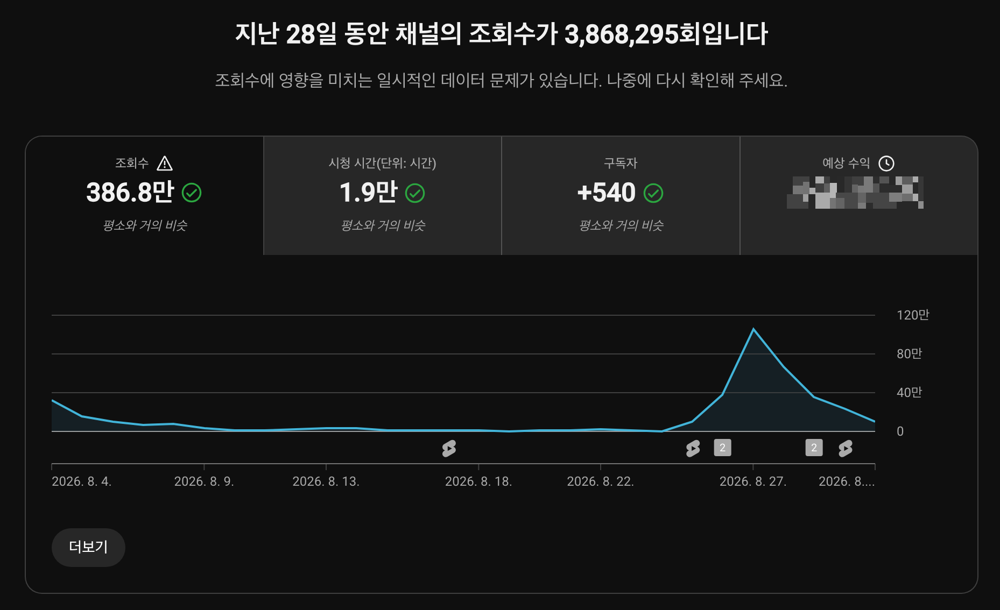

> 업데이트(2026-10-14): 처음 글은 "3주간 업로드가 멈췄던 채널을 쇼츠 3편으로 되살렸다"고 썼습니다. 업로드 기록을 다시 확인해 보니 그 기간에도 영상을 올렸고, 같은 나흘 동안 올린 쇼츠도 3편이 아니라 4편이었습니다. 기록에 맞게 다시 썼습니다.

업로드가 뜸해지면 채널이 끝난 건 아닐까 걱정하게 됩니다.\
제 채널(이하 채널 A)도 8월 중순에 그런 시기가 있었습니다.

## 8월 28일 동안의 그래프

8월 4일에 올린 쇼츠가 79.8만 회까지 가면서 그래프 왼쪽이 높게 시작합니다.\
그 뒤로 8월 9일부터 24일까지는 하루 조회수가 바닥에 붙어 있었습니다.

이 기간에 영상을 아예 안 올린 것은 아닙니다.\
8월 5일부터 24일까지 4편을 올렸지만 그중 60초 이하 쇼츠는 1편이었습니다.\
평소에는 일주일에 몇 편씩 올리던 채널입니다.

그러다 8월 25일 밤부터 27일 아침까지 쇼츠 4편을 올렸습니다.\
그래프는 하루 100만 회를 넘는 봉우리를 그렸습니다.

28일 합계는 조회수 386.8만 회, 시청 시간 1.9만 시간, 구독자 +540명입니다.\
흥미롭게도 스튜디오는 이 세 숫자에 모두 "평소와 거의 비슷"이라고 표시했습니다.

8월 초의 봉우리와 말일의 봉우리를 합치면 평소 수준이었다는 뜻입니다.\
채널이 죽었다가 살아났다기보다 비어 있던 2주를 새 영상들이 채운 모양에 가깝습니다.

## 나흘 동안 올린 4편

| 업로드 (한국 시간) | 길이 | 조회수 (9/1) | 평균 조회율 | 계속 시청함 |
| :--- | :---: | :---: | :---: | :---: |
| 8/25 밤 [Case 3] 세대 공감 유머 쇼츠 | 37초 | 64.9만 회 | 111.4% | 77.9% |
| 8/26 새벽 [Case 4] | 35초 | 10.2만 회 (10/6) | 74.1% (10/6) | 기록 없음 |
| 8/26 밤 [Case 1] 삼촌과 조카 감동 드라마 쇼츠 | 31초 | 102.4만 회 | 114.5% | 71.3% |
| 8/27 아침 [Case 2] 일상 코믹 티키타카 쇼츠 | 42초 | 99.0만 회 | 111.8% | 71.8% |

처음 글에서는 Case 4를 빼고 3편만 다뤘습니다.\
같은 나흘에 올렸는데 결과가 달랐던 영상이라 함께 놓는 게 맞습니다.

Case 4는 평균 조회율이 74.1%로 다른 세 편보다 크게 낮았고 조회수도 10만 회 남짓이었습니다.\
나흘 동안 몰아서 올린 영상이 모두 함께 뜬 것은 아니라는 뜻입니다.

## 잘 된 세 편의 피드 잔존율

[YouTube 고객센터의 쇼츠 분석 도움말](https://support.google.com/youtube/answer/12942217?hl=en&co=YOUTUBE._YTVideoType%3Dshorts)은 피드에서 시청자가 쇼츠를 넘기지 않고 보기로 선택한 비율을 확인하는 방법을 안내합니다.\
스튜디오에서는 "계속 시청함"으로 표시됩니다.

![[Case 3] 세대 공감 유머 쇼츠 (37초)의 계속 시청함 77.9% 스튜디오 화면](../../assets/blog/SCR-20260901-tfko.png)

Case 3은 77.9%였습니다.\
10명 중 8명 가까이가 넘기지 않고 봤습니다.

![[Case 1] 삼촌과 조카 감동 드라마 쇼츠 (31초)의 계속 시청함 71.3% 스튜디오 화면](../../assets/blog/SCR-20260901-tfpr.png)

Case 1은 71.3%, 순 시청자 40.5만 명이었습니다.

![[Case 2] 일상 코믹 티키타카 쇼츠 (42초)의 계속 시청함 71.8% 스튜디오 화면](../../assets/blog/SCR-20260901-tfue.png)

Case 2는 71.8%, 순 시청자 41.0만 명이었습니다.

세 편 모두 70%를 넘었습니다.\
다만 이 채널에는 58% 안팎으로 수백만 회까지 간 영상도 있습니다.\
그 이야기는 [예상과 달랐던 쇼츠 알고리즘 사례](/blog/2026-09-11-shorts-retention-vs-watch-time-share-algorithm/)에 있습니다.

그래서 70% 이상이어야 뜬다고 말할 수는 없습니다.\
이 세 편에서 피드 잔존율이 높았다는 기록입니다.

## 평균 조회율이 100%를 넘은 이유

![[Case 1] 31초 쇼츠의 조회수 102만 회와 평균 조회율 114.5% 스튜디오 화면](../../assets/blog/SCR-20260901-tfee-v2.png)

Case 1은 31초 영상을 평균 35초 봤습니다.

![[Case 2] 42초 쇼츠의 조회수 99만 회와 평균 조회율 111.8% 스튜디오 화면](../../assets/blog/SCR-20260901-tfcn-v2.png)

Case 2는 42초 영상을 평균 46초 봤습니다.

![[Case 3] 37초 쇼츠의 조회수 64만 회와 평균 조회율 111.4% 스튜디오 화면](../../assets/blog/SCR-20260901-tfft-v2.png)

Case 3은 37초 영상을 평균 41초 봤습니다.

100%가 넘는다는 것은 끝까지 본 뒤 앞부분을 다시 본 시청이 섞였다는 뜻입니다.\
세 편 모두 마지막 대사가 첫 장면으로 자연스럽게 이어지도록 편집했습니다.

그 편집이 평균 조회율을 얼마나 올렸는지는 따로 재지 않았습니다.

## 이 기록으로 말할 수 있는 것과 없는 것

말할 수 있는 것은 이렇습니다.\
2주 동안 조회수가 바닥에 붙어 있었어도 새로 올린 쇼츠가 100만 회까지 가는 데 걸림돌은 보이지 않았습니다.

말할 수 없는 것도 있습니다.\
나흘 동안 몰아서 올린 것이 효과가 있었는지는 이 기록으로 가를 수 없습니다.

같은 나흘에 올린 Case 4는 10만 회 남짓이었습니다.\
네 편을 하루씩 떨어뜨려 올렸다면 어땠을지는 비교할 기록이 없습니다.

채널 전체로 보면 업로드를 자주 하던 시기에 10만 회 넘는 영상의 비율이 높았습니다.\
그 비교는 [137편 실제 데이터로 본 길이·평균 조회율·업로드 빈도 기준](/blog/2026-10-06-shorts-growth-137-videos-length-retention-frequency/)에 정리했습니다.

## 업로드가 뜸했다면 먼저 볼 것

공백 기간에 조회수가 바닥이었다고 채널을 새로 만들 이유는 제 기록에서는 보이지 않았습니다.

새 영상을 올린 뒤에는 영상마다 계속 시청함 비율과 평균 조회율을 적어 두시길 권합니다.\
같은 시기에 올린 영상끼리 비교하면 무엇이 달랐는지 보기가 쉽습니다.

이 글의 Case 4처럼 같은 날 올렸는데 결과가 다른 영상이 가장 많은 것을 알려 줍니다.
