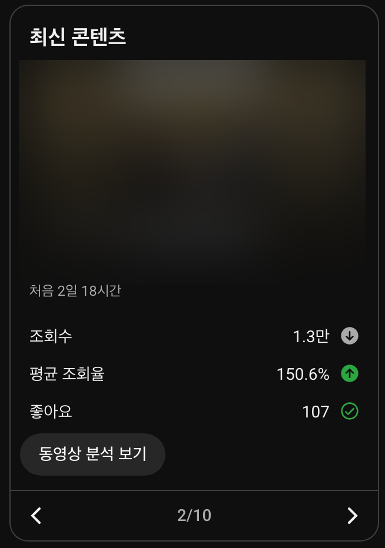
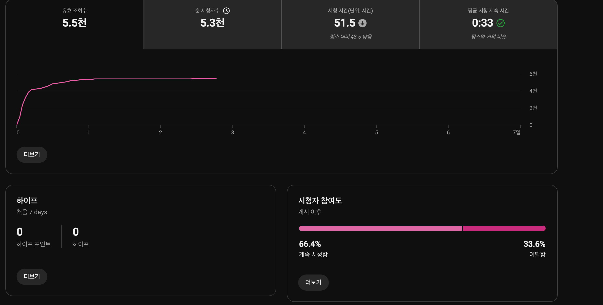
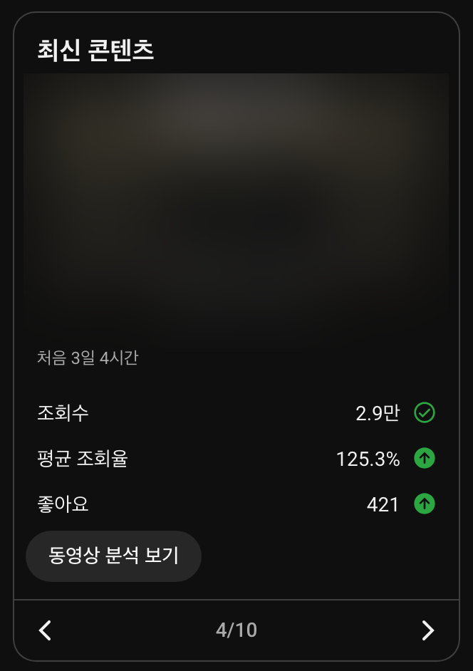
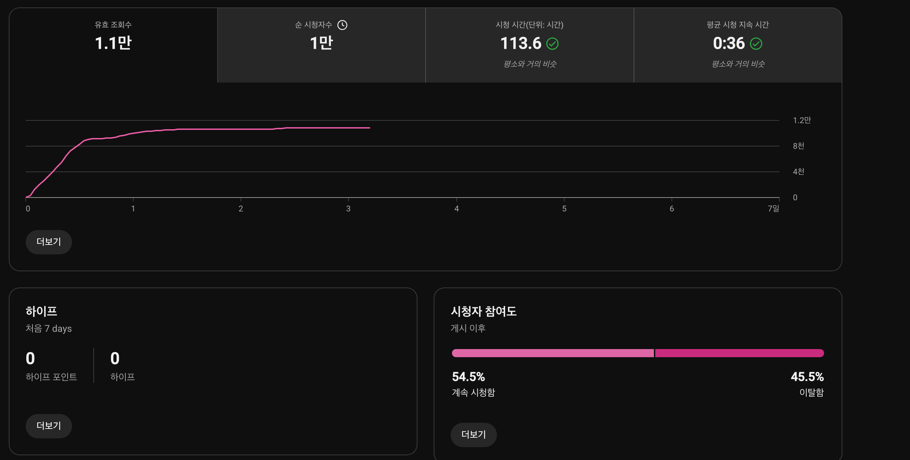

유튜브 쇼츠를 제작하는 창작자에게 가장 당혹스러운 순간 중 하나는 스튜디오 대시보드에 찍힌 높은 수치와 처참한 조회수 사이의 괴리를 마주할 때입니다. 새로 올린 숏폼 영상의 세부 분석을 열었을 때 평균 조회율이 120%를 넘어 150%를 가리키며 선명한 녹색 상승 화살표가 떠 있다면, 누구나 이 영상이 수십만 혹은 수백만 뷰로 뻗어나갈 것이라 기대하게 됩니다. 150%라는 수치는 시청자들이 영상을 끝까지 다 보고도 다시 한 번 반복해서 시청했다는 뜻이기 때문입니다.

하지만 기대와 달리 조회수 그래프는 1만 회 안팎에서 완벽한 수평선(Dead-Flat)을 그리며 멈춰 섭니다. 더 이상 추천 피드에 노출되지도 않고, 새로운 시청자 유입도 완전히 끊겨버립니다. 영상을 1.5번씩이나 돌려볼 정도로 몰입도가 높은데, 대체 왜 유튜브 알고리즘은 추천 공급을 차단해버린 것일까요?

> 업데이트(2026-10-14): 처음 글에서 '피드 잔존율 70% 관문'을 알고리즘 기준처럼 썼던 부분을 이 다섯 편에서 본 경향으로 고쳤습니다. 이 해석은 이후 사례(잔존율 55~58%에서도 250만 뷰 도달)로 보완되었습니다. 자세한 내용은 [예상과 달랐던 쇼츠 알고리즘 사례](/blog/2026-09-11-shorts-retention-vs-watch-time-share-algorithm/)을 참고해 주세요.

연구소 자체 운영 쇼츠 채널에서 최근 게시된 2편의 실제 스튜디오 데이터를 공개하고, 완주율(AVD)이라는 수치가 만들어내는 치명적인 착시와 알고리즘의 실제 작동 메커니즘을 심층 분석합니다.

---

## 영상으로 한눈에 보기: 150% 완주율보다 중요한 것

본 포스팅의 핵심 분석을 영상으로 정리했습니다. 글을 읽기 전 편하게 시청해 보세요.

  <iframe
    src="https://www.youtube-nocookie.com/embed/1dCibxRrrfQ"
    title="쇼츠 조회수의 진실 : 150% 완주율보다 중요한 건 따로 있다(왜 내 쇼츠는 완주율이 높은데 안 터질까?)"
    allow="accelerometer; autoplay; clipboard-write; encrypted-media; gyroscope; picture-in-picture; web-share"
    allowfullscreen
    loading="lazy">
  </iframe>

---

## 150% 완주율과 멈춰버린 그래프: 2편의 실제 스튜디오 데이터

아래 지표는 최근 자체 운영 채널에 업로드된 2편의 숏폼 드라마 콘텐츠의 실제 성과 지표입니다.

### 1. 22초 영상: [Case X] 서스펜스 대화 쇼츠 (22초)

게시 후 2일 18시간이 경과한 시점의 요약 화면입니다.
- 누적 조회수: 1.3만 회 (하향 화살표)
- 평균 조회율: 150.6% (상향 녹색 화살표)
- 좋아요: 107개

평균 조회율 150.6%는 매우 이례적으로 높은 수치입니다. 세부 분석 대시보드를 열어보면 이 영상의 실제 시청 행태가 더욱 극명하게 드러납니다.

- 영상 길이: 22초
- 평균 시청 지속 시간: 33초 (본편 길이보다 11초를 더 시청)
- 유효 조회수: 5.5천 회
- 피드 참여도: 계속 시청함 66.4% / 이탈함 33.6%

영상 길이가 22초인데 시청자들의 평균 시청 시간은 33초에 달했습니다. 시청자들이 영상을 반복해서 시청(루프 재생)했다는 뜻입니다. 하지만 유효 조회수는 5.5천 회에서 피드가 완전히 잠겼고, 누적 조회수 1.3만 회에서 곡선은 수평으로 누웠습니다.

### 2. 29초 영상: [Case Y] 시대극 명대사 쇼츠 (29초)

게시 후 3일 4시간이 지난 또 다른 영상의 지표입니다.
- 누적 조회수: 2.9만 회
- 평균 조회율: 125.3% (상향 녹색 화살표)
- 좋아요: 421개

이 영상 역시 125%가 넘는 높은 평균 조회율을 기록했습니다. 하지만 세부 대시보드의 참여도 지표를 보면 결정적인 약점이 나타납니다.

- 영상 길이: 29초
- 평균 시청 지속 시간: 36초 (125.3% 완주)
- 유효 조회수: 1.1만 회
- 피드 참여도: 계속 시청함 54.5% / 이탈함 45.5%

29초짜리 영상을 평균 36초 동안 시청했음에도 불구하고, 피드에 노출되었을 때 손가락을 넘기지 않고 머무른 사람의 비율(Stayed Rate)은 54.5%에 그쳤습니다. 10명 중 무려 4.5명이 초반 1~3초 안에 영상을 넘겨버린 것입니다.

---

## 100만 뷰 바이럴 쇼츠 vs 1만 뷰 정체 쇼츠 1:1 대조

이 미스터리를 풀기 위해서는 8월 말 나흘 동안 올려 65만~100만 뷰를 기록한 3편([기록](/blog/2026-09-01-youtube-shorts-channel-revival-retention-strategy/))의 데이터와 이번 정체 쇼츠 2편의 데이터를 나란히 비교해보아야 합니다.

| 콘텐츠 구분 | 영상 길이 | 평균 조회율 (AVD) | 계속 시청 (Stayed) | 스와이프 이탈 (Swiped) | 최종 조회수 성과 |
| :--- | :---: | :---: | :---: | :---: | :---: |
| [Case 1] 삼촌과 조카 감동 드라마 쇼츠 (31초) | 31초 | 114.5% | 71.3% | 28.7% | 102.4만 회 (메가히트) |
| [Case 2] 일상 코믹 티키타카 쇼츠 (42초) | 42초 | 111.8% | 71.8% | 28.2% | 99.0만 회 (메가히트) |
| [Case 3] 세대 공감 유머 쇼츠 (37초) | 37초 | 111.4% | 77.9% | 22.1% | 64.9만 회 (급상승) |
| [Case X] 서스펜스 대화 쇼츠 (22초) | 22초 | 150.6% (최고) | 66.4% | 33.6% | 1.3만 회 (정체) |
| [Case Y] 시대극 명대사 쇼츠 (29초) | 29초 | 125.3% (우수) | 54.5% (최저) | 45.5% | 2.9만 회 (정체) |

위 비교표에는 크리에이터의 통념을 완전히 뒤흔드는 역설이 담겨 있습니다.

100만 뷰를 돌파한 대박 영상들의 평균 조회율은 111%~114% 수준이었습니다. 반면 1.3만 뷰에 그친 영상의 평균 조회율은 150.6%로, 대박 영상들보다 무려 35%p 이상 높았습니다.

단순히 "평균 조회율이 높을수록 알고리즘이 밀어준다"는 공식이 맞다면, 150%를 기록한 영상이 100만 뷰를 가고 111%를 기록한 영상이 1만 뷰에 멈췄어야 합니다. 하지만 결과는 정반대였습니다. 표에서 두 묶음이 뚜렷하게 갈린 칸은 피드 유지율(계속 시청함 비율)과 영상 길이였습니다. 정체된 두 편은 22초, 29초로 더 짧았고, 피드 유지율도 더 낮았습니다.

---

## 다섯 편이 보여 준 순서: 먼저 선택받고, 그다음 끝까지 보기

이 다섯 편을 나란히 놓고 저는 이렇게 해석했습니다.\
피드에서 먼저 선택받아야 하고, 끝까지 보는 시청은 그다음에 힘을 쓴다는 순서입니다.

[YouTube 고객센터의 쇼츠 분석 도움말](https://support.google.com/youtube/answer/12942217?hl=en&co=YOUTUBE._YTVideoType%3Dshorts)은 피드에서 시청자가 쇼츠를 보기로 선택한 비율과 넘겨서 지나간 비율(Stayed vs Swiped away)을 지표로 제공합니다.\
이 비율을 추천에 어떻게 쓰는지는 공개되어 있지 않습니다. 아래는 이 채널 다섯 편을 보고 세운 저자의 해석입니다.

이 다섯 편만 보면 70% 안팎에서 결과가 갈린 것처럼 보였습니다.\
다만 다섯 편으로 본 경계입니다. 이후 같은 채널에서 58% 안팎으로 수백만 회까지 간 영상이 나왔습니다. 70%는 통과 기준이 아닙니다.

* 피드 유지율이 66.4%나 54.5%라면 10명 중 3.4~4.5명이 영상을 넘겼다는 뜻입니다.
* 이 두 편은 그 뒤로 추천이 늘지 않았습니다.
* 피드 잔존율이 70%를 넘은 세 편에서는 110%대 평균 조회율이 큰 조회수로 이어졌습니다.

### 150% 완주율은 누구의 숫자였나
그렇다면 [Case X] 22초 영상의 150.6% 완주율은 어떻게 나왔을까요?
* 피드에서 넘긴 33.6%의 시청은 짧게 끝났습니다.
* 반면 넘기지 않고 본 66.4%가 짧은 영상(22초)을 여러 번 돌려 보면서 평균이 올라갔습니다.
* 그래서 150%라는 숫자는 전체가 아니라 남아서 본 사람들의 반응에 가깝다고 봅니다.

---

## 피드에서 먼저 선택받기 위해 제가 바꾼 3가지

결말을 첫 장면과 자연스럽게 잇는 무이음 루프(Seamless Loop) 편집은 쓸 만한 방법입니다. 다만 이 다섯 편에서는 피드에서 먼저 선택받지 못한 영상의 높은 완주율이 조회수로 이어지지 않았습니다. 그 뒤로 제가 도입부에서 바꾼 것들입니다.

### 1. 첫 0.5초 안에 영상의 핵심 갈등을 시각화하기
[Case X] 쇼츠(22초)의 패인은 오프닝 0~2초 구간에 있었습니다. 두 인물이 악수를 나누는 장면으로 시작되었는데, 대사가 본격적으로 시작되기 전까지 시청자는 이 영상이 어떤 긴장감을 다루는지 알 수 없었습니다. 이 영상은 피드에서 33.6%가 넘겼습니다.

반면 77.9%의 잔존율을 기록했던 바이럴 영상들은 시작과 동시에 인물의 당황한 표정 클로즈업, 즉각적인 고성이나 반전 텍스트 바를 노출하여 시청자가 손가락을 움직일 틈 자체를 주지 않았습니다.

### 2. 모호한 호기심 유발보다 직관적인 상황 제시하기
[Case Y] 쇼츠(29초)의 경우 상단 텍스트 바가 "[Case Y] 시대극 명대사 쇼츠 (29초), 그리고 그걸 살리는 배우들"이었습니다. 이는 영상의 내용을 설명하기보다 제작자의 주관적 감상을 적어둔 것에 가깝습니다.

시청자는 피드를 넘기며 텍스트를 읽는 순간 "이게 무슨 상황이지?"를 파악하지 못하면 즉시 스와이프합니다. 인물들이 어떤 관계로 맞서는지 한눈에 보여 주는 상황 텍스트를 배치하는 편이 낫다고 봅니다.

### 3. 결말 반전보다 도입부의 군더더기 1초를 쳐내기
많은 크리에이터들이 영상 마지막에 1초를 더 보게 만들려고 엔딩 컷을 다듬는 데 많은 시간을 씁니다. 제 경험으로는 영상 끝부분의 1초보다 영상 시작 부분의 정적 0.5초를 먼저 손보는 편이 낫습니다.

대사가 시작되기 전 숨을 고르는 찰나, 배경음악만 흐르는 도입부 컷은 잘라냅니다. 음성과 화면 전환을 0초 프레임에서 함께 시작하는 것이 제가 쓰는 방법입니다.

---

## 다섯 편에서 배운 것

유튜브 쇼츠에서 100%를 넘는 완주율은 분명 창작자에게 자부심을 주는 훌륭한 지표입니다. 하지만 이 다섯 편에서는 피드 잔존율이 낮은 영상의 높은 완주율이 조회수로 이어지지 않았습니다.

저는 첫인상에서의 대중적 수용성과 심층적인 사용자 경험이 조화를 이룰 때 배포 범위가 확장된다고 해석합니다.

"어떻게 영상을 두 번 보게 만들까"를 고민하기 전에, 어떻게 첫 3초 안에 손가락을 멈추게 만들 것인가를 먼저 해결해야 합니다. 높은 완주율은 피드에서 먼저 선택받은 뒤에야 힘을 쓴다는 것이 이 다섯 편이 보여 준 모습입니다.
