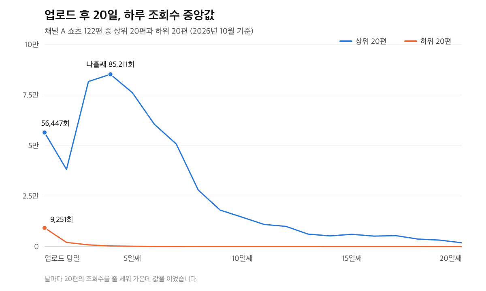

지난 글에서는 쇼츠 137편을 조회수 순으로 줄 세웠습니다.\
맨 위 20편이 전체 조회수의 77%를 가져갔습니다.

그때는 잘 나온 영상이 어디에 몰려 있는지를 봤습니다.\
이번에는 반대쪽 끝을 봅니다.

아래 20편에는 무엇이 있었을까요?

제가 운영하는 쇼츠 채널(이하 채널 A)의 같은 영상들입니다.\
막 올린 영상처럼 같은 선에서 비교하기 어려운 영상 15편을 빼고 122편으로 봤습니다.\
조회수는 10월 6일 기준입니다.

상위 20편은 모두 54만 회를 넘었습니다.\
하위 20편은 가장 많이 본 영상이 약 2.6만 회입니다.

지난 글은 [쇼츠 성장 방법: 137편 실제 데이터로 본 길이·평균 조회율·업로드 빈도 기준](/blog/2026-10-06-shorts-growth-137-videos-length-retention-frequency/)에 있습니다.

## 한눈에 본 차이

| 항목 | 하위 20편 | 상위 20편 |
|---|---|---|
| 평균 길이 | 40.9초 | 39.6초 |
| 평균 조회율 | 87.5% | 101.1% |
| 업로드 당일 조회수 (중앙값) | 9,251회 | 56,447회 |
| 업로드 당일과 다음날 합계 (중앙값) | 13,735회 | 86,711회 |
| 업로드 시각 (중앙값) | 오후 6시 23분 | 오후 8시 15분 |

길이는 1초 남짓 차이라 사실상 같습니다.\
안 나온 영상이 길어서 안 나왔다고 볼 근거는 이 채널에 없었습니다.

차이가 큰 칸은 두 곳입니다.\
평균 조회율, 그리고 업로드 당일 조회수입니다.

## 평균 조회율은 14%p 낮았습니다

하위 20편의 평균 조회율은 87.5%입니다.\
상위 20편은 101.1%입니다.

지난 글에서 이 채널은 평균 조회율 100~120% 구간의 조회수가 가장 높았습니다.\
상위 20편의 평균이 그 구간에 들어가 있습니다.

그렇다고 조회율이 낮아서 안 나왔다고 말하기는 어렵습니다.\
두 숫자가 함께 움직였다는 데까지만 확인됩니다.\
어느 쪽이 먼저인지는 이 숫자로 가를 수 없습니다.

평균 조회율이 높아도 1만에서 멈춘 영상은 [평균 조회율 150%의 함정](/blog/2026-09-05-shorts-retention-rate-vs-avd-algorithm/)에서 따로 다뤘습니다.

## 차이는 업로드한 날 이미 6배였습니다

이번 비교에서 가장 큰 차이는 첫날에 있었습니다.

업로드 당일 조회수 중앙값이 하위 20편은 9,251회, 상위 20편은 56,447회입니다.\
약 6배입니다.

여기서 업로드 당일은 업로드한 시각부터 그날 자정까지입니다.\
상위 20편은 하위 20편보다 업로드 시각이 두 시간쯤 늦었습니다.

첫날이 대체로 더 짧았는데도 조회수는 6배였던 셈입니다.

그다음 며칠은 더 크게 갈렸습니다.

하위 20편은 다음날 조회수가 2,043회로 첫날의 4분의 1이 안 됐습니다.\
나흘째에는 302회였습니다.

상위 20편은 사흘째와 나흘째에 첫날보다 더 많이 봤습니다.\
나흘째 중앙값이 85,211회입니다.

그래프의 선은 날마다 20편의 가운데 값을 이은 것이라 영상 한 편의 모양과는 다릅니다.\
그래도 방향은 분명합니다.

안 나온 영상은 첫날 받은 관심이 이튿날부터 줄었습니다.\
잘 된 영상은 그 관심이 며칠 동안 커졌습니다.

## 나중에 살아난 하위 영상은 없었습니다

조회수가 언젠가 다시 오를 거라는 기대도 확인해 봤습니다.

하위 20편 중 19편은 업로드 당일이나 다음날 조회수가 가장 많았습니다.\
나머지 1편은 나흘째에 하루 반짝 올랐다가 바로 다음날 200회 남짓으로 떨어졌습니다.

20일이 지난 뒤에도 조금씩 쌓인 영상은 있었습니다.\
5천 회대에서 9천 회대로 늘어난 영상도 있습니다.

하지만 하위권을 벗어난 영상은 한 편도 없었습니다.

늦게 터진 영상은 오히려 다른 쪽에 있었습니다.\
업로드 후 20일 기록이 모두 남은 128편 가운데 일주일이 지나서 정점을 찍은 영상은 3편입니다.

3편 모두 최종 조회수가 26만~433만 회였습니다.\
이 채널에서 늦게 터진 영상은 처음부터 하위에 있던 영상이 아니었습니다.

## 밤 9시 이후 업로드가 많았지만

상위 20편 중 10편이 밤 9시에서 자정 사이에 올라갔습니다.\
하위 20편은 6편이었습니다.

다만 밤 9시 이후에 올린 영상은 업로드를 가장 자주 하던 4월부터 6월 사이에 몰려 있습니다.\
시간대 때문인지 그 시기 때문인지는 이 데이터로 가를 수 없습니다.

시간대별 비교는 [쇼츠 업로드 시간, 122편으로 확인해 본 골든타임](/blog/2026-08-20-shorts-upload-golden-time/)에 따로 정리했습니다.

## 내 채널의 하위 영상에서 먼저 볼 것

하위 영상을 고칠 단서는 영상 한 편 안보다 업로드 첫 며칠에 더 많았습니다.

스튜디오에서 조회수가 적은 영상 몇 편을 열고 업로드 당일과 다음날 조회수를 적어 보시길 권합니다.\
잘 된 영상 몇 편도 똑같이 적습니다.

다음날 조회수가 첫날보다 크게 줄었는지, 오히려 늘었는지를 봅니다.\
여러분 채널에서도 이 채널처럼 첫 이틀에 갈린다면 영상이 처음 노출된 사람들의 반응을 먼저 들여다볼 차례입니다.

그 반응은 영상마다 볼 수 있습니다.\
YouTube 고객센터의 [Content 탭 분석 도움말](https://support.google.com/youtube/answer/12942217?hl=en&co=YOUTUBE._YTVideoType%3Dshorts)에 피드에서 쇼츠를 넘기지 않고 보기로 선택한 비율을 확인하는 방법이 나와 있습니다.\
분석 화면 전체 구성은 [YouTube Analytics 시작하기](https://support.google.com/youtube/answer/9002587)에서 볼 수 있습니다.

## 이 숫자를 믿기 전에 알아 둘 점

채널 하나, 영상 122편의 기록입니다.\
지운 영상은 빠져 있습니다.

20편씩 묶은 비교라 한두 편만 달라져도 중앙값이 움직입니다.\
여기서 본 것은 함께 움직였다는 관계일 뿐 원인이 아닙니다.

그래도 하나는 이 채널에서 분명했습니다.\
안 나온 쇼츠는 나중에도 안 나왔고, 그 차이는 업로드한 날부터 보였습니다.
