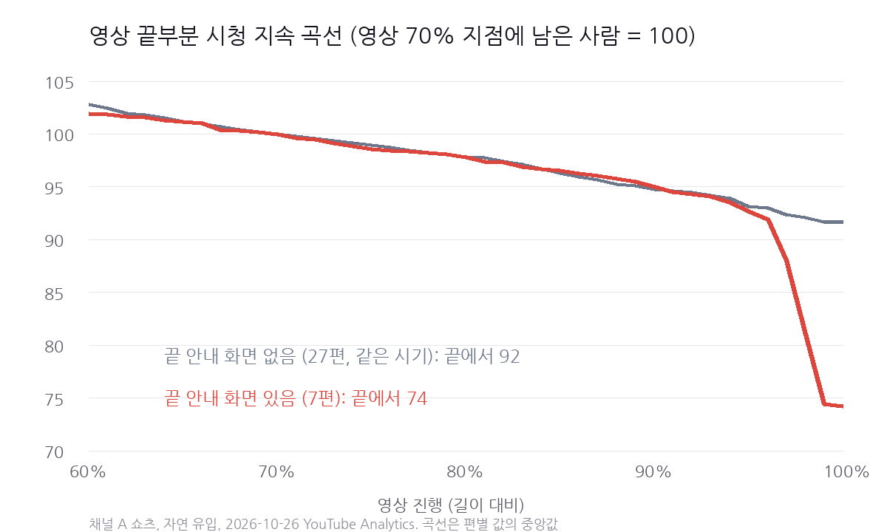

9월 22일부터 2주 동안 쇼츠 7편의 끝에 안내 화면을 붙였습니다.\
작품 포스터 위에 'OTT에서 시청 가능합니다'라는 글자를 얹은 2\~4초짜리 화면입니다.\
그 7편은 마지막 3초에 보던 사람의 12.3%(중앙값)를 잃었습니다.\
안내 화면이 없는 102편은 2.5%였습니다.

제가 운영하는 쇼츠 채널(이하 채널 A)의 기록입니다.\
지금까지는 조회수와 평균 조회율 같은 합계 숫자로 쇼츠를 봤습니다.\
합계로는 시청자가 몇 초에 나갔는지 알 수 없습니다.\
그래서 이번에는 영상 안쪽, 시청 지속 곡선을 142편 모두 꺼내 봤습니다.

나가는 곳은 두 군데로 모였습니다.\
4\~7초, 그리고 끝 안내 화면이 나오는 마지막 3초입니다.

## 곡선을 받은 방법과 읽는 법

YouTube Analytics에서 영상마다 길이를 100칸으로 나눈 곡선을 받았습니다.\
각 칸에는 그 순간 남아서 보는 사람의 비율이 들어 있습니다.\
지표 이름과 정의는 [YouTube Analytics API 지표 문서](https://developers.google.com/youtube/analytics/metrics)의 audienceWatchRatio, stoppedWatching 항목에 있습니다.

조건은 이렇습니다.

- 채널 A가 직접 만든 쇼츠 142편(2026년 2월 11일\~10월 23일 게시). 의뢰받아 만든 영상 16편은 따로 봤습니다.
- 자연 유입만, 게시일부터 10월 26일까지. YouTube 스튜디오 화면의 곡선과 조금 다를 수 있습니다.
- 이 글의 이탈 %는 보기 시작한 사람 가운데 그 구간에서 나간 비율입니다.

앞 3초는 해석하지 않았습니다.\
쇼츠는 끝나면 다시 처음부터 재생됩니다.\
그래서 앞부분 이탈에는 한 번 다 보고 다시 보다가 나간 사람이 섞입니다.\
YouTube 스튜디오의 '계속 시청함' 비율을 곡선 첫 1\~4초로 흉내 내 봤는데, 12편에서 둘의 상관은 0.1 안팎이었습니다.\
넘기기를 보려면 곡선이 아니라 스튜디오의 그 숫자를 봐야 합니다.

[YouTube 고객센터의 시청 지속 시간 도움말](https://support.google.com/youtube/answer/9314415?hl=ko)은 곡선이 떨어지는 구간을 시청자가 건너뛰거나 시청을 그만둔 곳으로 설명합니다.\
이 글은 그 하락이 어디에 모였는지를 142편으로 센 기록입니다.

## 4\~7초: 넘기기를 지난 뒤 한 번 더 고릅니다

15초 이상인 139편에서 4\~7초 이탈의 중앙값은 17.5%였습니다.\
보기 시작한 사람 여섯에 한 명꼴입니다.\
가운데 절반은 14.1\~21.1%, 가장 적은 편이 6.7%, 가장 많은 편이 38.3%였습니다.

짧은 영상일수록 이 구간에서 더 많이 나갔습니다.

| 길이 | 영상 수 | 4\~7초 이탈 (중앙값) |
|---|---|---|
| 15\~29초 | 21편 | 21.1% |
| 30\~39초 | 33편 | 20.1% |
| 40\~49초 | 60편 | 17.1% |
| 50\~60초 | 23편 | 15.2% |

20초 영상에서 4\~7초는 전체의 15%쯤이고, 50초 영상에서는 6%쯤입니다.\
같은 3초라도 짧은 영상에서는 차지하는 몫이 큽니다.\
그래서 길이를 맞춰 다시 봤습니다.\
30\~55초인 110편을 4\~7초 이탈 순으로 세 묶음으로 나눴습니다.

| 4\~7초 이탈 | 영상 수 | 길이 (중앙값) | 조회수 (중앙값) | 10만 회 이상 | 1만 회 미만 |
|---|---|---|---|---|---|
| 적게 나감 (6.7\~15.7%) | 36편 | 43초 | 63,411회 | 16편 | 0편 |
| 가운데 (15.9\~19.0%) | 36편 | 44초 | 37,064회 | 8편 | 2편 |
| 많이 나감 (19.4\~38.3%) | 38편 | 40초 | 34,210회 | 8편 | 7편 |

4\~7초에 적게 나간 묶음에서 10만 회를 넘긴 영상이 두 배였습니다.\
1만 회 미만으로 끝난 영상은 한 편도 없었고요.

이 표는 함께 나타난 모습입니다.\
장면 자체가 강하면 4\~7초도 잘 버티고 조회수도 높았을 수 있습니다.\
4\~7초를 붙잡아서 멀리 갔다고 말할 수는 없습니다.

한 편을 열어 본 적은 있습니다.\
4\~7초 이탈이 26.5%였던 49초 영상입니다.\
처음 11초가 해설 자막 두 줄과 인물의 반응 장면으로만 이어졌습니다.\
채널 A는 보통 첫 대사가 강하면 그 대사로 바로 엽니다.\
이 영상은 그 반대였습니다.\
한 편이라 규칙으로 쓰지는 않습니다.

## 마지막 3초: 끝 안내 화면에서 나갔습니다

곡선 끝을 보다가 이상한 영상이 몇 편 눈에 띄었습니다.\
대부분 마지막 3초에 1\~4%만 나가는데, 몇 편은 10\~30%가 나갔습니다.\
완성본 끝 화면을 하나씩 열어 봤죠.\
그 편들의 끝에는 모두 안내 화면이 있었습니다.

완성본을 찾을 수 있었던 111편을 끝 화면으로 나눴습니다.

| 끝 화면 | 영상 수 | 마지막 3초 이탈 (중앙값) | 맨 끝에서 나감 (중앙값) | 마지막 3초 8% 이상 |
|---|---|---|---|---|
| 안내 화면 있음 | 7편 | 12.3% (9.7\~30.0%) | 22.2% | 7편 모두 |
| 안내 화면 없음 | 102편 | 2.5% (0\~15.3%) | 2.6% | 3편 |

안내 화면 없이 8%를 넘은 3편 중 2편은 10초짜리 영상입니다.\
10초 영상에서 마지막 3초는 영상의 30%입니다.\
15초 이상만 놓고 보면 안내 화면 없는 100편 중 가장 큰 값이 8.6%였습니다.

'맨 끝에서 나감'은 끝까지 본 사람 가운데 다시 보기로 넘어가지 않고 떠난 비율입니다.\
안내 화면 영상은 22.2%, 없는 영상은 2.6%였습니다.\
안내 화면이 '이야기는 여기서 끝났다'는 신호처럼 읽힌 듯합니다.\
보는 중에 나가거나, 끝까지 봐도 다시 보기로 이어지지 않았습니다.

두 곡선은 영상의 95% 지점 가까이까지 거의 겹칩니다.\
갈라지는 곳은 안내 화면이 나오는 마지막 몇 칸뿐입니다.

시기가 겹쳐서 생긴 차이인지도 확인했습니다.

| 게시 시기 | 끝 화면 | 영상 수 | 마지막 3초 이탈 (중앙값) | 평균 조회율 (중앙값) |
|---|---|---|---|---|
| 8월 1일\~9월 21일 | 없음 | 14편 | 2.3% | 93.2% |
| 9월 22일\~10월 6일 | 있음 | 7편 | 12.3% | 93.3% |
| 10월 7일\~23일 | 없음 | 13편 | 1.4% | 100.5% |

앞뒤 시기와 평균 조회율은 비슷했습니다.\
안내 화면을 붙인 동안만 마지막 3초 이탈이 올랐고, 뺀 뒤 바로 내려왔습니다.

의뢰받아 만든 영상 16편도 같은 쪽이었습니다.\
끝에 작품 로고와 공개 안내 화면이 붙은 8편은 마지막 3초 이탈이 12.8%, 없는 8편은 1.8%(중앙값)였습니다.

## 그래서 바꾼 것

10월 7일 이후 영상에는 끝 안내 화면을 넣지 않았습니다.\
지금은 이야기의 마지막 대사에서 영상을 끝냅니다.\
작품을 어디서 볼 수 있는지 알려야 할 때는 두 가지 중 하나로 합니다.

- 마지막 장면 위에 작은 글자로 얹기. 영상 길이를 늘리지 않고, 해설로 읽지 않습니다.
- 설명란에 적기.

의뢰받은 영상은 의뢰한 쪽이 요구하는 끝 화면을 따릅니다.

## 내 채널에서 확인하는 순서

YouTube 스튜디오에서 쇼츠 한 편을 열고 분석의 참여도 탭으로 가면 시청 지속 시간 곡선이 있습니다.

1. 4\~7초 사이에서 곡선이 얼마나 내려가는지 봅니다. 채널 A의 기준은 보기 시작한 사람의 17.5%(중앙값)입니다. 내 채널의 다른 영상과 비교하는 편이 더 정확합니다.
2. 많이 내려간 영상이면 그 3초에 화면과 자막이 무엇이었는지 봅니다. 대사 없이 설명만 이어지는 구간인지 확인합니다.
3. 마지막 3초를 봅니다. 곡선이 끝에서 갑자기 꺾이면 그 3초에 무엇을 붙였는지 봅니다. 안내 화면, 구독 부탁, 다음 편 예고처럼 이야기가 끝난 뒤의 화면이 있다면 빼 보시길 권합니다.

앞 3초의 하락은 다시 보기와 섞여 있으니 곡선만으로 판단하지 않습니다.\
넘기기는 스튜디오의 '계속 시청함' 비율로 봅니다.

## 이 숫자를 믿기 전에 알아 둘 점

채널 하나의 기록입니다.\
안내 화면 영상은 7편이고, 모두 9월 말\~10월 초 2주에 올라갔습니다.\
작품도 앞뒤 시기와 다릅니다.

안내 화면 7편의 조회수(중앙값 18,598회)는 앞뒤 시기보다 낮았습니다.\
작품이 달라 이것을 안내 화면 탓으로 돌릴 수는 없습니다.\
이 글이 말하는 것은 마지막 3초에 사람이 나갔다는 것까지입니다.

4\~7초와 조회수의 관계도 마찬가지로 상관입니다.\
완성본 짝을 찾지 못한 31편은 끝 화면 비교에서 뺐습니다.

## 이 기록은 계속 이어집니다

채널 A에는 지금도 새 쇼츠가 올라가고, 영상마다 곡선을 받아 둡니다.\
10월 7일 이후 영상은 모두 안내 화면 없이 끝납니다.

2027년 1월 말에 같은 방법으로 다시 재겠습니다.\
볼 것은 두 가지입니다.\
안내 화면 없는 11\~12월 영상에서도 마지막 3초 이탈이 낮게 유지되는지.\
4\~7초 세 묶음의 차이가 영상이 늘어도 남는지.

결과가 이번과 다르면 이 글에 덧붙여 고치겠습니다.\
틀린 것으로 드러난 부분도 지우지 않고 남겨 둡니다.

함께 읽을 글: [쇼츠 3초 훅과 시청 지속 시간](/blog/2026-08-19-shorts-opening-hook-strategy/), [쇼츠 첫 48시간이 이후 조회수를 얼마나 설명할까](/blog/2026-10-22-shorts-first-48-hours-127-videos/)
